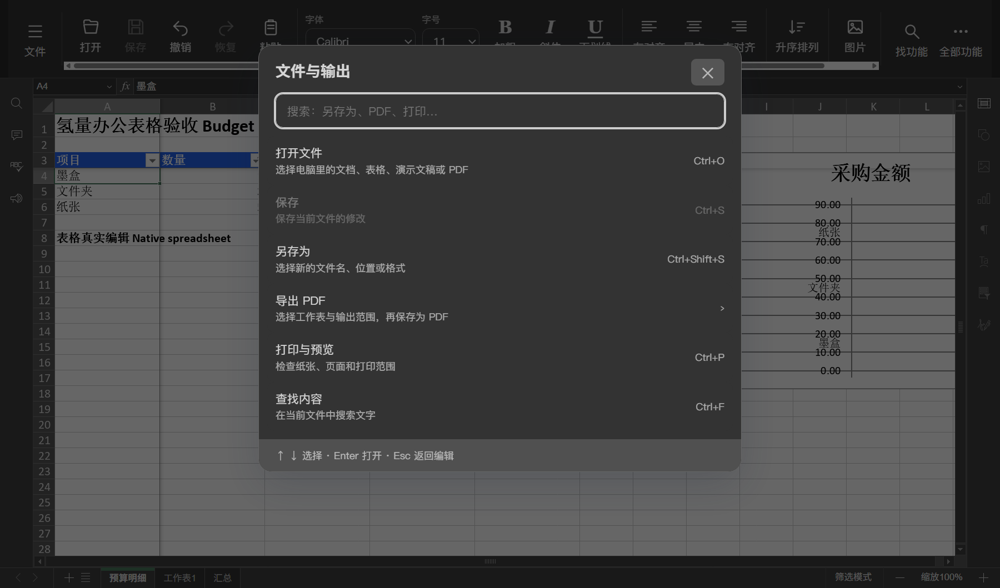
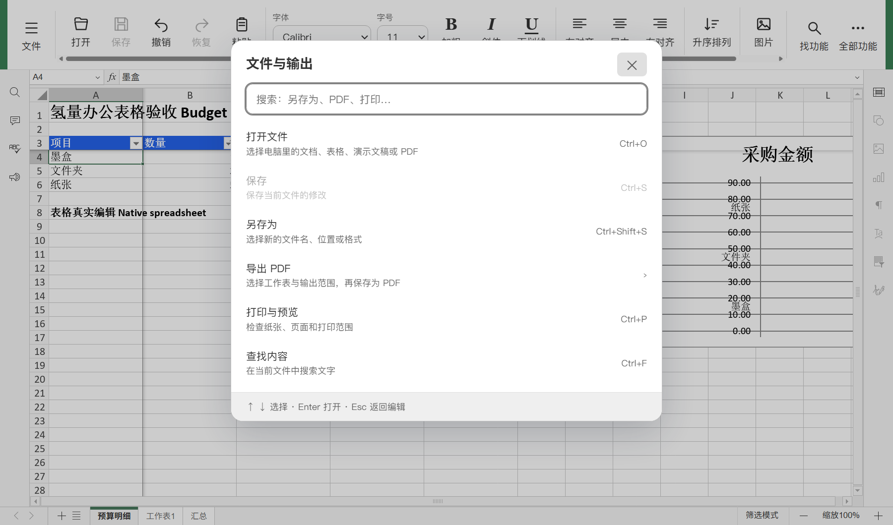

# 表格与编辑区交互质量

最新 PDF 的 40 项普通流程、16 项空白字段专项，以及 SDK 字体加载修复见 [PDF-QUALITY.md](PDF-QUALITY.md)；同一资源布局重跑本页 DOCX/XLSX 及 PPTX 回归通过，工具检查现为 152 项通过、1 项权限跳过。以下保留各前序阶段当时的计数。

后续同一资源布局新增 47 项真实 PPTX 验收，并重跑本页的 DOCX 40 项、XLSX 50 项检查；工具检查现为 146 项通过、1 项权限跳过。放映入口与启动工具修复见 [PRESENTATION-QUALITY.md](PRESENTATION-QUALITY.md)，以下保留最初表格质量阶段的细节与计数。

2026-10-23，本机统一重建五类桌面编辑器界面后，50 项真实 XLSX 流程检查和 40 项 DOCX 回归通过。新增修复集中在排序、工具栏切换、主题、键盘焦点及短动效。整体软件完善目标仍在进行；这不代表表格全部功能或整个界面已经验收。

## 用户可见的变化

- 表格快捷栏的“升序排列”连接当前 DataTab 创建的排序控件，支持其类似数组的控件集合和延后创建过程，继续遵守原控件的保护/禁用状态。此前只找旧 `btnSortDown` 字段导致错误禁用；把新集合当单个按钮调用也会产生异常。
- “全部功能”保留完整工具栏；“返回简洁”位于原工具栏标题层之上，能够真实点击。
- 常用工具栏、字体/字号控件、文件/功能菜单使用原编辑器主题颜色，随原生明暗设置变化。文字颜色立即更新，避免主题切换时文字与背景渐变不同步；实际表格窗口的常用操作文字对比度为深色 8.71、浅色 12.63。
- 按 SDK 输入边界保留工具栏控件的键盘焦点，菜单支持方向键选择、Esc 关闭和返回入口；点击加粗后直接继续文档输入也经真实操作回归。
- 悬停阴影、按下位移和菜单的短淡入/展开提供反馈；菜单动画 120–160ms，不等待动画结束才执行命令。CEF 的减少动效偏好会关闭相关过渡、动画和位移。

完整修改文件见 `editor-sources/web-apps/apps/common/main/lib/controller/SimpleToolbar.js`，相对冻结父版本的差异见 `editor-patches/quick-toolbar-quality.patch`。父版本 SHA256 为 `553dd850f0e0915435c38ead48e54f2c64f31ef68b126b7fcb03ba1303f44421`，身份由 `editor.inputs.lock.json` 校验；冻结的 96 文件和五份原补丁保持不变。

## 构建与运行

先按 [EDITOR-BUILD.md](EDITOR-BUILD.md) 在同一稳定 staging 完成原生组件和桌面编辑资源构建。修改编辑界面后可验证并复用既有 SDKJS：

```powershell
python tools/build_editors.py build --skip-install --reuse-sdk --work-dir D:\CodexCache\qingliang-community-build --archive-cache D:\CodexCache\office-windows\downloads
```

`--reuse-sdk` 核对四套桌面 SDK 的固定配置、全部实际源码输入和两份输出脚本哈希，任何不符都会停止。它不省略界面构建和资源审计；本轮最终布局包含全部五类编辑器。排错阶段的单编辑器构建单独记录，不作为完整布局通过的证据。

已有未知源码、生成文件或验收样本修改时会保留并停止。验收样本在删除任何已知工作副本前先全部检查；预检失败不会更新先前的文件归属记录。异步保存以实际 XLSX 内容和稳定文件哈希确认，不能仅凭保存按钮禁用判断写盘完成。

## 真实 Windows 验收

在独立 Python 环境安装 `tests/editor-requirements.txt`，关闭该 staging 的预览后运行：

```powershell
python tests/run_spreadsheet_tests.py --work-dir D:\CodexCache\qingliang-community-build --qt-dir D:\Qt\5.15.2\msvc2019_64 --evidence-dir D:\CodexWorkspaces\qingliang-spreadsheet-evidence
python tests/run_editor_tests.py --work-dir D:\CodexCache\qingliang-community-build --qt-dir D:\Qt\5.15.2\msvc2019_64 --evidence-dir D:\CodexWorkspaces\qingliang-word-evidence
```

表格 50/50 通过，使用真实 Qt/CEF、原生接口、界面输入和 Windows Save As 对话框，没有注入编辑器或保存替身。样本来自独立 openpyxl，保存后分别以公式模式和缓存值模式读取：

- 打开含两个工作表、合并标题、筛选范围、日期/数字格式和图表结构的工作簿。
- 修改数字、录入公式和中文、撤销/重做、加粗、通过完整工具栏设置百分比。
- 通过快捷按钮整行排序，撤销后再次排序；检查项目、数量、单价、相对公式及日期一起移动。
- 添加工作表和跨表引用；独立读取缓存值，验证金额、合计和跨表结果均为实际计算结果。
- 正常关闭并以新进程重开；验证文件字节和清洁状态。另从空模板新建，原生另存大写 `.XLSX` 并核对公式结果。
- 在实际编辑区切换原生明暗主题，检查文字对比度、菜单、方向键/Esc、焦点、视口和减少动效；三次正常退出码均为 0，观察到的 JavaScript 异常为 0。

同一布局的 DOCX 40/40 回归覆盖原有编辑/格式、加粗后继续输入、保存、正常退出重开、新建另存及 PDF 输出。工具检查共 143 项，142 项通过，1 项因 Windows 符号链接权限跳过。

结果 JSON 记录主程序、宿主 DLL、编辑资源构建、运行布局及测试源码身份，DOCX/XLSX 原始输入保留。各测试报告的未覆盖标记只描述该套测试的范围；实际构建成功、真实 GUI 结果和整体产品完成状态分别记录。[Editor source checks](../.github/workflows/editor-checks.yml) 在 Windows/Linux 验证锁、补丁、JavaScript 语法和 17 项编辑器保护/SDK 字体方法测试，另有三个 Windows 真实进程检查（Linux 跳过）；不宣称云端执行了 GUI 验收。

## 界面样例与剩余范围

以下是实际嵌入式 CEF 编辑区，内容为本项目生成的验收样例：





图表目前只验证保存后的结构保留，未据此认定图形渲染正确；实际筛选值、真实 Windows IME/剪贴板、大文件、复杂公式和兼容性仍需扩展验收。演示完整编辑/放映、PDF 表单、插件/OCR/媒体、保存失败/恢复、全部原生窗口/对话框及界面缩放、真实任务进度、性能和安装升级仍未完成。完整目标及条件见 [PRODUCT-QUALITY-PLAN.md](PRODUCT-QUALITY-PLAN.md)。当前仍无公开安装包。
