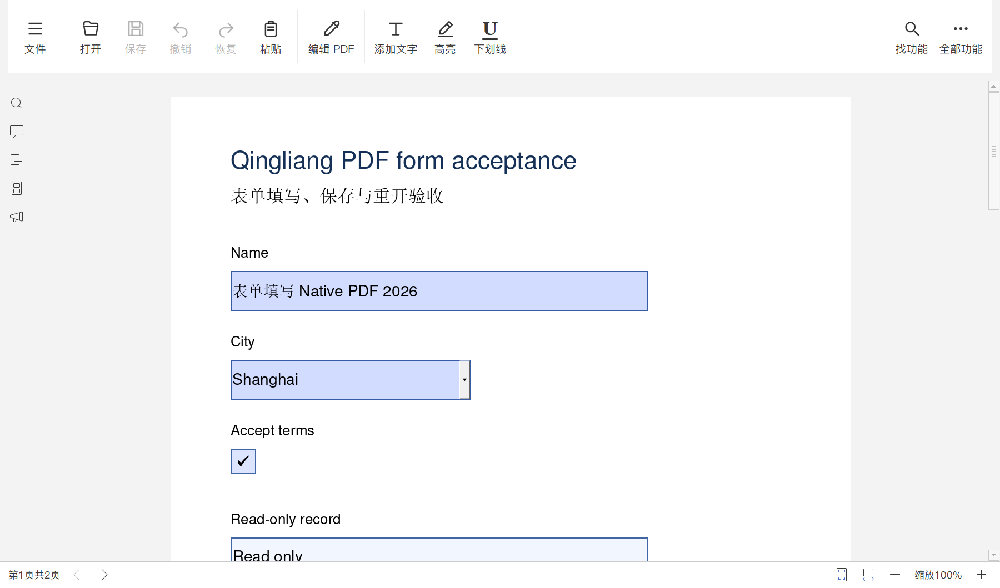
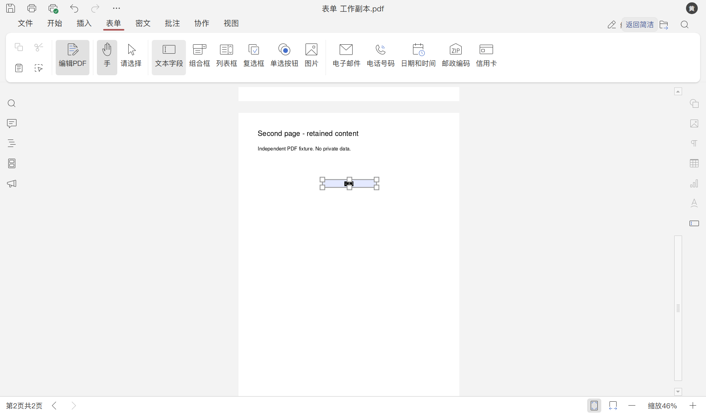

# PDF 表单与编辑入口

2026-10-23，本机普通 PDF 表单的 40/40 项真实检查通过；冷启动输入、实际保存、正常退出后重开及原生另存均包含在内。空白新字段的保存重开另有 16/16 项专项回归通过，复杂表单不据此判为完成。

本轮修复 PDF 下拉框选择与快速切换焦点之间的错误、首次中文输入的首字丢失，并在简洁工具栏增加“编辑 PDF”。文字、页面和表单工具仍由原编辑器提供，按原生权限和模式显示；当前验收只覆盖下列普通表单流程。

## 修复与实际行为

PDF 下拉菜单原先延迟 1ms 执行选择。选中菜单项后快速按 Tab，原生 `activeForm` 可能已变成复选框，随后下拉选项写入会调用错误类型的字段并触发编辑错误。现于菜单选择事件内立即提交，避免焦点先改变；保留原生字段处理、校验和历史记录。完整文件见 `editor-sources/web-apps/apps/pdfeditor/main/app/controller/DocumentHolderExt.js`，固定上游父版本和累计差异见 `editor.inputs.lock.json`、`editor-patches/pdf-form-selection.patch`。

冷启动后首次输入中文时，字符所需的回退字体已由全局加载器载入，PDF 字段自己的字体清单还没有更新。原 `checkFieldFont` 即使同步完成加载也返回 false，导致文本控制器忽略首字。现区分同步完成与真正等待：同步时让调用者直接继续，异步时只回调一次，避免重复进入鼠标或输入处理。完整文件见 `editor-sources/sdkjs/pdf/src/document.js`，差异见 `editor-patches/pdf-field-font-loading.patch`；单元检查直接执行该源方法，覆盖同步、异步和已加载情形。

桌面 SDK 覆盖层单独记录在 `editor.inputs.lock.json` 的 `sdk_overlays`，只替换编译器选中的文件输入；固定转换器 SDK 源树和原 96 文件不改动。构建/复用同时检查父文件、修改文件和输出身份，不能把旧 SDK 结果套到新修复上。

“编辑 PDF”快捷按钮直接连接原生模式按钮；功能搜索根据实际模式显示“编辑 PDF”或“返回阅读与批注”。进入编辑模式后，功能搜索才显示可用的插入、表单和密文工具，不把权限不允许的工具伪装成可用。快捷按钮沿用主题颜色、原生禁用/按下状态和已有减少动效支持。

## 构建与真实验收

按 [EDITOR-BUILD.md](EDITOR-BUILD.md) 准备原生组件和固定资源，在同一稳定 staging 构建，再安装独立读取器运行：

```powershell
python tools/build_editors.py build --skip-install --work-dir D:\CodexCache\qingliang-community-build --archive-cache D:\CodexCache\office-windows\downloads
python -m pip install -r tests/editor-requirements.txt
python tests/run_pdf_tests.py --work-dir D:\CodexCache\qingliang-community-build --qt-dir D:\Qt\5.15.2\msvc2019_64 --evidence-dir D:\CodexWorkspaces\qingliang-pdf-evidence
python tests/run_pdf_tests.py --empty-field-cycle-only --work-dir D:\CodexCache\qingliang-community-build --qt-dir D:\Qt\5.15.2\msvc2019_64 --evidence-dir D:\CodexWorkspaces\qingliang-pdf-empty-evidence
```

样例由独立 PyMuPDF 创建，为两页普通 AcroForm，包含文字框、下拉框、复选框和只读字段。测试使用真实 Qt/CEF、Chromium 键鼠事件和 Windows 文件对话框，没有替换编辑器或保存接口：

- 读取原有页面/字段，实际缩放、翻页，填写中英文文字、撤销/重做，切换字段提交编辑。
- 鼠标及键盘选择下拉项后立即按 Tab，核对目标字段值及无编辑错误；勾选复选框，检查只读字段拒绝输入。
- 进入原生编辑模式，通过完整表单工具在第二页新增文字字段，填写后保存。
- 以独立读取器核对五个字段值、页面、类型、下拉选项、只读标记、原文字和填写后的外观，并渲染两个页面。
- 正常退出后以新进程重开，核对实际字段值；使用真实原生另存对话框保存 `.PDF` 副本，检查扩展名、原文件保护及可编辑字段保留。

保存验收等待独立文件内容正确、文件哈希连续稳定及原生清洁状态；遇到原生错误提示立即失败。每份报告记录二进制、资源布局、构建、测试源码和启动工具身份；全部既有样本先预检，未知修改会被保留。

同一新 SDK/界面布局的 DOCX 40 项、XLSX 50 项、PPTX 47 项回归通过；工具检查共 153 项，152 项通过，1 项因 Windows 符号链接权限跳过。17,215 个实际运行资源复制文件逐一核对哈希，固定转换器 SDK 父文件保持原字节。源码 CI 的锁/补丁/同步异步方法测试不代替本机 GUI 验收。

## 空白字段专项回归与剩余范围

排错时曾出现“新增空白文字字段后先保存，重开再填写时原生保存失败，新值没有写入”的情况。修正字段字体加载判断后，使用新 SDK 从头创建空白字段，再正常退出、重开填写并保存，最后以第三个进程读取新值，专项复测通过。失败证据保留，常规套件中首次保存前已填写的字段没有被用于替代此路径。

`--empty-field-cycle-only` 使用独立目录标记和 `pdf-empty-field-result.json`，与普通套件的 `pdf-test-result.json` 分开，防止相互覆盖证据。报告中的覆盖标记只说明该套测试的范围；默认套件不包含专项流程，不表示其他套件没有执行。全部 PDF 表单功能仍未完成。

复杂/动态表单、PDF JavaScript、数字签名、加密权限、密文效果、图片/页面复杂编辑、实际打印和真实 Windows IME/剪贴板尚未验收；另存 PDF 副本保留表单，不代表已验证打印或扁平化。完整产品、插件和安装目标仍见 [PRODUCT-QUALITY-PLAN.md](PRODUCT-QUALITY-PLAN.md)。

## 实际界面




