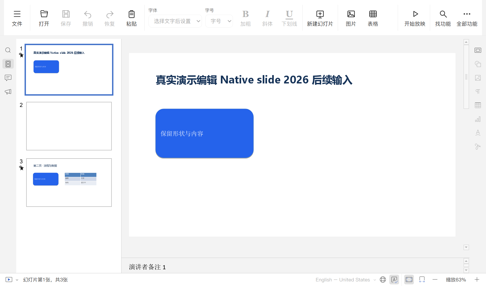
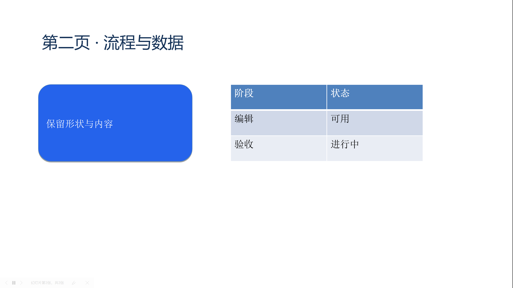

# 演示编辑与放映

2026-10-23，本机 47/47 项真实 PPTX 检查通过，覆盖实际编辑、保存重开、放映和 PDF 输出。完整产品目标仍见 [PRODUCT-QUALITY-PLAN.md](PRODUCT-QUALITY-PLAN.md)；这组样例不覆盖全部演示功能。

## 常用入口

简洁工具栏右侧增加常驻“开始放映”，从当前幻灯片播放，不随中间工具区横向滚出。功能搜索提供“从当前页放映”和“从头开始放映”，并提示方向键换页、Esc 结束。两种入口连接原编辑器的真实放映处理器，保留其禁用状态和完整工具栏。按钮沿用已有明暗主题、键盘焦点及减少动效设置。

修改文件及相对冻结父版本的累计差异仍位于 `editor-sources/`、`editor-patches/quick-toolbar-quality.patch`，由 `editor.inputs.lock.json` 固定。原 96 文件和五份补丁没有改动。

## 构建与验证

先按 [EDITOR-BUILD.md](EDITOR-BUILD.md) 构建原生程序和资源，再在同一稳定目录重建界面；SDK 复用仍须逐项核对源码配置与输出：

```powershell
python tools/build_editors.py build --skip-install --reuse-sdk --work-dir D:\CodexCache\qingliang-community-build --archive-cache D:\CodexCache\office-windows\downloads
python -m pip install -r tests/editor-requirements.txt
python tests/run_presentation_tests.py --work-dir D:\CodexCache\qingliang-community-build --qt-dir D:\Qt\5.15.2\msvc2019_64 --evidence-dir D:\CodexWorkspaces\qingliang-presentation-evidence
```

测试使用独立 python-pptx 生成两页样例，实际打开源码构建的 Qt/CEF 编辑器，通过 Chromium 键盘/鼠标事件编辑，并使用真实 Windows 文件对话框保存。独立读取器核对实际写盘内容和稳定文件哈希；保存按钮变灰本身不是写盘完成的证据。

- 编辑中英文标题、撤销/重做、加粗后继续输入；移动已有形状，新建幻灯片并撤销/重做。
- 保存后独立检查标题及加粗、形状位置/尺寸/填充、表格单元格、演讲者备注与既有淡化切换。转换器会将切换写成合法的 `mc:Choice`/`mc:Fallback`，检查兼容该表示。
- 从当前页放映，键盘换页、鼠标显示控制栏、上一页按钮和 Esc 返回；另从功能搜索启动首页放映。实际截图用于检查播放页面内容。
- 从真实文件菜单导出三页 PDF，以 PyMuPDF 独立读取并渲染第一页；确认原 PPTX 字节和编辑上下文保持。
- 正常关闭，启动新进程重开保存结果；另以原生 `--new:slide` 创建新文件，输入标题并另存大写 `.PPTX`，核对文件名不重复追加扩展名。

结果 `presentation-test-result.json` 记录主程序、宿主 DLL、编辑资源构建、运行布局、测试源码和原生会话辅助代码的哈希。预检会先检查全部既有样本；未知修改会被保留，不能因后续失败而被重新登记成已知文件。

最终三次原生关闭均正常退出，未观察到 JavaScript 异常。初次完整执行在正常退出后重启时被启动工具误拦截；Windows 在其他句柄释放前仍可保留已退出的进程对象。`launch_qt_preview.py` 现检查进程退出状态和实际程序路径，不再仅凭 PID 可打开判定预览存活；三个真实子进程测试分别覆盖仍运行的本程序、无关程序和保留句柄的已退出程序。失败报告保留，修复后重新完整执行的结果才计为通过。

同一统一布局的 DOCX 40/40、XLSX 50/50 回归通过；工具检查 147 项中 146 项通过，1 项因 Windows 符号链接权限跳过。原生程序与宿主 DLL 本轮未变，界面资源已重新构建并记录身份。

## 实际窗口与边界





这组检查验证普通样例的保存和交互。淡化切换的属性保留与换页成功不等于切换时长、帧率或所有对象动画已验收；多媒体播放、图片编辑、主题替换、复杂母版、动画序列、真实 Windows IME/剪贴板和跨软件兼容性仍需扩展。PDF 输出也不代替 PDF 表单编辑验收。历史 PPTX 异常没有据此全部结案，当前仍无公开安装包。
